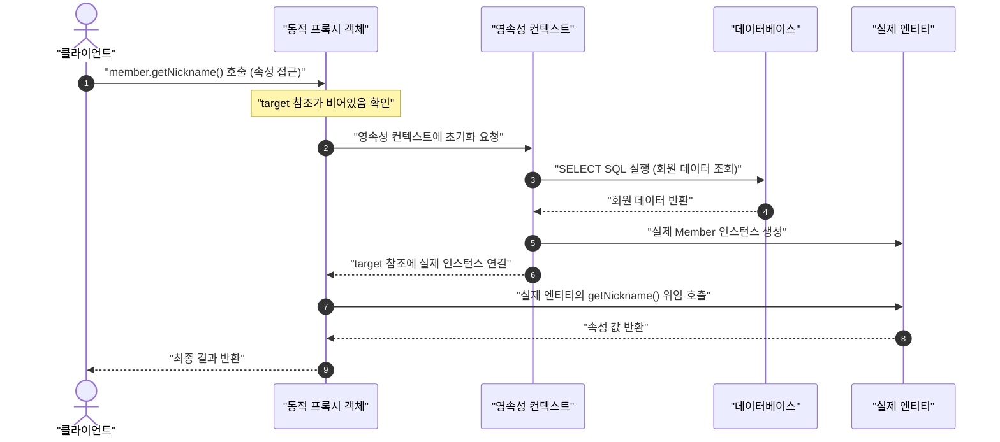

# 6. 스프링 부트 Data JPA 3 - 도메인 완성 및 계층 아키텍처 구축

## 학습 목표
- 지연 로딩(LAZY)과 프록시 객체의 초기화 메커니즘을 이해하고 안전한 DTO 변환 원칙을 습득함.
- Spring Data JPA의 JpaRepository 공통 인터페이스를 기반으로 7개 SNS 도메인 리포지토리를 완성함.
- 엔티티와 화면 계층의 결합도를 분리하기 위한 요청(Request) 및 응답(Response) DTO 파이프라인을 설계함.
- 부모-자식 연관관계(Post-Comment), 비즈니스 행위 토글(PostLike, Bookmark), 다대다 매핑(Tag, PostHashtag)을 처리하는 서비스 계층을 완성함.
- RESTful 원칙에 입각한 컨트롤러 API를 구축하고 웹 계층 통합 테스트로 데이터 정합성을 검증함.

---

## 목차
- [1. 지연 로딩 프록시와 Spring Data JPA 기본 아키텍처](#1-지연-로딩-프록시와-spring-data-jpa-기본-아키텍처)
  - [1.1 지연 로딩 메커니즘과 프록시 객체의 생명주기](#11-지연-로딩-메커니즘과-프록시-객체의-생명주기)
  - [1.2 Spring Data JPA 개요와 인터페이스 프록시 구현체 원리](#12-spring-data-jpa-개요와-인터페이스-프록시-구현체-원리)
  - [1.3 지연 로딩 환경의 안전한 DTO 변환 원칙](#13-지연-로딩-환경의-안전한-dto-변환-원칙)
- [2. SNS 전 도메인 Repository 인터페이스 구축](#2-sns-전-도메인-repository-인터페이스-구축)
  - [2.1 회원 및 상세 정보 리포지토리](#21-회원-및-상세-정보-리포지토리)
  - [2.2 게시글 및 댓글 리포지토리](#22-게시글-및-댓글-리포지토리)
  - [2.3 상호작용(좋아요, 북마크) 리포지토리](#23-상호작용좋아요-북마크-리포지토리)
  - [2.4 해시태그 매핑 리포지토리](#24-해시태그-매핑-리포지토리)
- [3. DTO 설계와 비즈니스 서비스 계층 구현](#3-dto-설계와-비즈니스-서비스-계층-구현)
  - [3.1 회원 관리 서비스와 프로필 갱신 로직](#31-회원-관리-서비스와-프로필-갱신-로직)
  - [3.2 게시글-댓글 연관관계 라이프사이클 서비스](#32-게시글-댓글-연관관계-라이프사이클-서비스)
  - [3.3 좋아요 및 북마크 토글 비즈니스 로직](#33-좋아요-및-북마크-토글-비즈니스-로직)
  - [3.4 게시글 작성 시 해시태그 자동 추출 및 연계 등록](#34-게시글-작성-시-해시태그-자동-추출-및-연계-등록)
- [4. RESTful API 컨트롤러와 웹 계층 연동](#4-restful-api-컨트롤러와-웹-계층-연동)
  - [4.1 회원 API 엔드포인트 구현](#41-회원-api-엔드포인트-구현)
  - [4.2 게시글 및 댓글 API 엔드포인트 구현](#42-게시글-및-댓글-api-엔드포인트-구현)
  - [4.3 상호작용 행위 토글 API 구현](#43-상호작용-행위-토글-api-구현)
- [5. 전 계층 통합 테스트 및 동작 검증](#5-전-계층-통합-테스트-및-동작-검증)
  - [5.1 게시글 및 댓글 작성-조회 통합 검증](#51-게시글-및-댓글-작성-조회-통합-검증)
  - [5.2 좋아요 토글 및 복합 유니크 제약 정합성 검증](#52-좋아요-토글-및-복합-유니크-제약-정합성-검증)
  - [5.3 해시태그 자동 연계 등록 검증](#53-해시태그-자동-연계-등록-검증)
- [6. 각주](#6-각주)

---

# 1. 지연 로딩 프록시와 Spring Data JPA 기본 아키텍처

## 1.1 지연 로딩 메커니즘과 프록시 객체의 생명주기
JPA에서 연관관계 매핑 시 `FetchType.LAZY`를 지정하면, 연관된 엔티티는 데이터베이스에서 즉시 조회되지 않고 동적으로 생성된 프록시(Proxy) 객체 형태로 주입됨.

- 프록시 객체의 특성
  - 프록시는 실제 엔티티 클래스를 상속받아 런타임에 바이트코드 조작 라이브러리(ByteBuddy [각주])로 동적 생성됨.
  - 실제 객체의 참조(`target`)를 내부 멤버로 보관하며, 초기 상태에서는 `target`이 비어 있음.
  - 프록시 객체의 메서드를 최초로 호출하여 속성 값에 접근하는 순간 영속성 컨텍스트에 초기화를 요청함.
- 프록시 객체 초기화 3단계 흐름
  - 1단계: 클라이언트가 `post.getMember()`를 호출하여 연관 객체 참조를 획득함. 이때 반환되는 인스턴스는 실제 `Member`가 아닌 동적 프록시 객체(`Member$HibernateProxy`).
  - 2단계: 클라이언트가 `member.getNickname()`처럼 식별자(PK) 이외의 실제 필드에 접근하는 메서드를 호출함.
  - 3단계: 프록시 객체는 영속성 컨텍스트에 실제 엔티티 조회를 요청하고, 데이터베이스에서 SELECT SQL을 실행하여 실제 `Member` 인스턴스를 생성한 뒤 `target` 참조에 연결함. 이후 실제 인스턴스의 `getNickname()`을 위임 호출함.



- 지연 로딩 예외(LazyInitializationException)
  - 프록시 초기화는 반드시 트랜잭션 범위 안에서 영속성 컨텍스트가 살아있는 동안에만 수행 가능함.
  - 트랜잭션이 종료(`@Transactional` 메서드 종료)된 후 컨트롤러나 뷰 템플릿 계층에서 프록시 객체의 필드에 접근하면 영속성 컨텍스트가 닫혀 있어 `LazyInitializationException`이 발생함.

## 1.2 Spring Data JPA 개요와 인터페이스 프록시 구현체 원리

### 1.2.1 순수 JPA의 보일러플레이트 한계와 도입 배경
- 순수 JPA 환경에서는 각 도메인 엔티티마다 개발자가 리포지토리 클래스를 만들고 `EntityManager`를 주입받아 반복적인 CRUD 코드(`persist`, `find` 등)를 직접 작성해야 했음.
- 도메인 엔티티가 늘어날수록 유사한 데이터 접근 코드가 중복되는 비효율이 발생함.
- Spring Data JPA는 이러한 반복을 제거하기 위해 개발자가 인터페이스만 선언하면 스프링이 런타임에 리포지토리 구현체를 메모리에 동적으로 생성하여 등록해 주는 데이터 접근 편의 프레임워크에 해당함.

### 1.2.2 JPA 기술 스택 3단계 계층 관계
- JPA (표준 규약): 자바 진영의 ORM 표준 인터페이스 명세(EntityManager 인터페이스 등).
- Hibernate (구현 엔진): JPA 표준 명세를 실제로 구현하여 SQL을 동적으로 생성하고 데이터베이스와 통신을 수행하는 오픈소스 ORM 프레임워크.
- Spring Data JPA (추상화 계층): JPA와 하이버네이트를 더욱 편리하게 다룰 수 있도록 리포지토리 인터페이스 기반의 구현체 자동 생성을 지원하는 스프링 모듈.

### 1.2.3 JpaRepository 상속 구조와 개발자의 역할
- 개발자는 리포지토리 인터페이스를 선언하고 `JpaRepository<엔티티타입, ID타입>`을 상속(`extends`)함.
- 예시
  ```java
  public interface MemberRepository extends JpaRepository<Member, Long> {
      // 인터페이스 선언만으로 기본 CRUD(save, findById, findAll, deleteById)가 자동 제공됨
  }
  ```
- 상속 계층 구조
  - `Repository` <- `CrudRepository` <- `ListCrudRepository` / `PagingAndSortingRepository` <- `JpaRepository`

### 1.2.4 인터페이스 프록시 생성 과정
- 스프링 부트 구동 시 메인 패키지 하위의 리포지토리 인터페이스를 자동으로 탐색.
- 스프링 AOP 프록시 팩토리가 각 인터페이스에 대해 `SimpleJpaRepository` 클래스를 기반 타깃으로 하는 프록시 인스턴스 동적 생성.
- 개발자가 구현 클래스를 직접 만들지 않아도 의존성 주입(`@Autowired` 또는 생성자 주입)을 통해 서비스 계층에서 즉시 사용 가능.

## 1.3 지연 로딩 환경의 안전한 DTO 변환 원칙
엔티티는 데이터베이스 테이블 구조와 직접 맞물려 있는 영속 객체이므로, 프레젠테이션 계층(Controller, View)으로 직접 노출하지 않아야 함.

### 1.3.1 엔티티 직접 노출 시 발생하는 문제점
- Jackson 라이브러리가 양방향 연관관계 엔티티를 JSON으로 직렬화할 때 상호 참조로 인한 `StackOverflowError` 무한 루프 발생.
- `FetchType.LAZY` 프록시 객체가 JSON 직렬화 대상이 될 때 초기화 실패 예외 또는 의도치 않은 대량 추가 쿼리 발생.
- 화면 요구사항 변경(특정 컬럼 포맷팅, 추가 연산 필드)이 도메인 엔티티 코드에 침범하여 테이블 설계가 훼손됨.

### 1.3.2 요청(Request)과 응답(Response) DTO 분리 원칙
- 데이터 흐름 방향과 요구 필드가 완전히 다르므로 반드시 별도의 DTO로 분리해야 함.
- 요청 DTO: 클라이언트 입력값 수신, 비밀번호(`password`) 및 입력 검증 어노테이션(`@NotBlank`, `@Email` 등) 포함. 데이터베이스 자동 생성 값(`id`, `createdAt`)은 제외.
- 응답 DTO: 클라이언트 화면 출력 데이터, 비밀번호 등 민감 정보는 배제하고 화면에 필요한 식별자(`id`), 포맷팅된 일시, 가공 필드(작성자 닉네임, 댓글 수 등) 포함.
- 단일 DTO 재사용 시 비밀번호 누출이나 클라이언트의 임의 식별자 변조(Mass Assignment) 취약점이 발생함.

### 1.3.3 최신 DTO 설계 및 네이밍 트렌드
- 자바 레코드(Java Record) 활용: 불변성(Immutable)을 보장하며 생성자, Getter, equals, hashCode, toString이 자동 생성되어 보일러플레이트 코드를 제거함.
- 도메인 단위 중첩 레코드(Static Nested Record) 패턴: 도메인마다 수많은 DTO 클래스 파일이 난립하는 것을 방지하기 위해 단일 외부 클래스(`MemberDto`) 내부에 요청/응답 레코드(`CreateRequest`, `Response`)를 중첩 선언하여 높은 응집도를 유지함.
- 명확한 네이밍 컨벤션: 클래스명 끝에 습관적으로 붙이던 사족 접미사(`...Dto`)를 지양하고, `Request`, `Response`로 역할을 명확히 규정함 (`MemberDto.CreateRequest`, `MemberDto.Response`).

### 1.3.4 안전한 DTO 변환 파이프라인 원칙
- 엔티티의 조회 및 DTO 변환은 반드시 트랜잭션 경계(`@Transactional`) 내부인 서비스 계층에서 완결해야 함.
- 조회할 필드만 선별하여 불변 데이터 객체로 변환한 후 컨트롤러로 전달함.
- 화면에서 전달받은 요청 데이터는 Request DTO의 `toEntity()` 또는 서비스 계층 생성자 로직을 통해 엔티티로 변환하고, 응답 데이터는 DTO의 정적 팩토리 메서드(`from()`)를 통해 생성함.

- MemberDto.java 예시
  ```java
  package net.likelion.bebc25.jpasns.dto;

  import net.likelion.bebc25.jpasns.domain.Member;
  import net.likelion.bebc25.jpasns.domain.Role;

  public class MemberDto {

      // 화면 요청 데이터를 안전하게 수신하는 불변 Request DTO
      public record CreateRequest(
          String email,
          String password,
          String username,
          String nickname
      ) {
          public Member toEntity() {
              return new Member(email, password, username, nickname, Role.USER);
          }
      }

      // 엔티티 직접 노출과 순환 참조를 방지하는 Response DTO
      public record Response(
          Long id,
          String email,
          String nickname,
          String role
      ) {
          // 트랜잭션 내부에서 엔티티를 DTO로 변환하는 정적 팩토리 메서드
          public static Response from(Member member) {
              return new Response(
                  member.getId(),
                  member.getEmail(),
                  member.getNickname(),
                  member.getRole().name()
              );
          }
      }
  }
  ```
---

# 2. SNS 도메인 Repository 인터페이스 구축

## 2.1 회원 및 상세 정보 리포지토리
회원 기본 엔티티(`Member`)와 1:1 식별 관계로 연결된 상세 프로필 엔티티(`MemberDetail`)를 관리하는 리포지토리 인터페이스.

- MemberRepository (src/main/java/net/likelion/bebc25/jpasns/repository/MemberRepository.java)
  ```java
  package net.likelion.bebc25.jpasns.repository;

  import java.util.Optional;
  import net.likelion.bebc25.jpasns.domain.Member;
  import org.springframework.data.jpa.repository.JpaRepository;

  public interface MemberRepository extends JpaRepository<Member, Long> {

      Optional<Member> findByEmail(String email);

      Optional<Member> findByUsername(String username);

      boolean existsByEmail(String email);

      boolean existsByUsername(String username);
  }
  ```

- MemberDetailRepository (src/main/java/net/likelion/bebc25/jpasns/repository/MemberDetailRepository.java)
  ```java
  package net.likelion.bebc25.jpasns.repository;

  import net.likelion.bebc25.jpasns.domain.MemberDetail;
  import org.springframework.data.jpa.repository.JpaRepository;

  public interface MemberDetailRepository extends JpaRepository<MemberDetail, Long> {
  }
  ```

## 2.2 게시글 및 댓글 리포지토리
게시글(`Post`)과 해당 게시글에 1:N으로 연결된 댓글(`Comment`)을 관리하는 리포지토리 인터페이스. 페이징 및 작성자별 조회 쿼리 메서드 선언.

- PostRepository (src/main/java/net/likelion/bebc25/jpasns/repository/PostRepository.java)
  ```java
  package net.likelion.bebc25.jpasns.repository;

  import java.util.List;
  import net.likelion.bebc25.jpasns.domain.Member;
  import net.likelion.bebc25.jpasns.domain.Post;
  import org.springframework.data.domain.Page;
  import org.springframework.data.domain.Pageable;
  import org.springframework.data.jpa.repository.JpaRepository;

  public interface PostRepository extends JpaRepository<Post, Long> {

      Page<Post> findAllByOrderByCreatedAtDesc(Pageable pageable);

      List<Post> findByMemberOrderByCreatedAtDesc(Member member);
  }
  ```

- CommentRepository (src/main/java/net/likelion/bebc25/jpasns/repository/CommentRepository.java)
  ```java
  package net.likelion.bebc25.jpasns.repository;

  import java.util.List;
  import net.likelion.bebc25.jpasns.domain.Comment;
  import net.likelion.bebc25.jpasns.domain.Post;
  import org.springframework.data.jpa.repository.JpaRepository;

  public interface CommentRepository extends JpaRepository<Comment, Long> {

      List<Comment> findByPostOrderByCreatedAtAsc(Post post);

      long countByPost(Post post);
  }
  ```

## 2.3 상호작용(좋아요, 북마크) 리포지토리
회원과 게시글 간의 좋아요(`PostLike`) 및 북마크(`Bookmark`) 행위를 관리하는 리포지토리 인터페이스. 존재 여부 확인과 삭제 처리를 위한 쿼리 메서드 선언.

- PostLikeRepository (src/main/java/net/likelion/bebc25/jpasns/repository/PostLikeRepository.java)
  ```java
  package net.likelion.bebc25.jpasns.repository;

  import java.util.Optional;
  import net.likelion.bebc25.jpasns.domain.Member;
  import net.likelion.bebc25.jpasns.domain.Post;
  import net.likelion.bebc25.jpasns.domain.PostLike;
  import org.springframework.data.jpa.repository.JpaRepository;

  public interface PostLikeRepository extends JpaRepository<PostLike, Long> {

      Optional<PostLike> findByMemberAndPost(Member member, Post post);

      boolean existsByMemberAndPost(Member member, Post post);

      long countByPost(Post post);
  }
  ```

- BookmarkRepository (src/main/java/net/likelion/bebc25/jpasns/repository/BookmarkRepository.java)
  ```java
  package net.likelion.bebc25.jpasns.repository;

  import java.util.List;
  import java.util.Optional;
  import net.likelion.bebc25.jpasns.domain.Bookmark;
  import net.likelion.bebc25.jpasns.domain.Member;
  import net.likelion.bebc25.jpasns.domain.Post;
  import org.springframework.data.jpa.repository.JpaRepository;

  public interface BookmarkRepository extends JpaRepository<Bookmark, Long> {

      Optional<Bookmark> findByMemberAndPost(Member member, Post post);

      boolean existsByMemberAndPost(Member member, Post post);

      List<Bookmark> findByMemberOrderByCreatedAtDesc(Member member);
  }
  ```

## 2.4 해시태그 매핑 리포지토리
독립 태그 엔티티(`Tag`)와 게시글-태그 간의 다대다 연결 엔티티(`PostHashtag`)를 관리하는 리포지토리 인터페이스.

- TagRepository (src/main/java/net/likelion/bebc25/jpasns/repository/TagRepository.java)
  ```java
  package net.likelion.bebc25.jpasns.repository;

  import java.util.Optional;
  import net.likelion.bebc25.jpasns.domain.Tag;
  import org.springframework.data.jpa.repository.JpaRepository;

  public interface TagRepository extends JpaRepository<Tag, Long> {

      Optional<Tag> findByName(String name);
  }
  ```

- PostHashtagRepository (src/main/java/net/likelion/bebc25/jpasns/repository/PostHashtagRepository.java)
  ```java
  package net.likelion.bebc25.jpasns.repository;

  import java.util.List;
  import net.likelion.bebc25.jpasns.domain.Post;
  import net.likelion.bebc25.jpasns.domain.PostHashtag;
  import net.likelion.bebc25.jpasns.domain.Tag;
  import org.springframework.data.jpa.repository.JpaRepository;

  public interface PostHashtagRepository extends JpaRepository<PostHashtag, Long> {

      List<PostHashtag> findByPost(Post post);

      List<PostHashtag> findByTag(Tag tag);

      void deleteByPost(Post post);
  }
  ```

---

# 3. DTO 설계와 비즈니스 서비스 계층 구현

## 3.1 회원 관리 서비스와 프로필 갱신 로직
회원 정보 조회와 1:1 연관관계인 회원 상세 프로필(`MemberDetail`)을 함께 갱신하는 비즈니스 서비스.

- MemberDTO 정의 (src/main/java/net/likelion/bebc25/jpasns/dto/MemberDTO.java)
  ```java
  package net.likelion.bebc25.jpasns.dto;

  import net.likelion.bebc25.jpasns.domain.Member;
  import net.likelion.bebc25.jpasns.domain.MemberDetail;

  public class MemberDTO {

      public record MemberResponse(
          Long id,
          String email,
          String username,
          String nickname,
          String role,
          String bio,
          String profileImageUrl
      ) {
          public static MemberResponse from(Member member, MemberDetail detail) {
              return new MemberResponse(
                  member.getId(),
                  member.getEmail(),
                  member.getUsername(),
                  member.getNickname(),
                  member.getRole().name(),
                  detail != null ? detail.getBio() : null,
                  detail != null ? detail.getProfileImageUrl() : null
              );
          }
      }

      public record ProfileUpdateRequest(
          String nickname,
          String bio,
          String profileImageUrl
      ) {}
  }
  ```

- MemberService (src/main/java/net/likelion/bebc25/jpasns/service/MemberService.java)
  ```java
  package net.likelion.bebc25.jpasns.service;

  import lombok.RequiredArgsConstructor;
  import net.likelion.bebc25.jpasns.domain.Member;
  import net.likelion.bebc25.jpasns.domain.MemberDetail;
  import net.likelion.bebc25.jpasns.dto.MemberDTO.MemberResponse;
  import net.likelion.bebc25.jpasns.dto.MemberDTO.ProfileUpdateRequest;
  import net.likelion.bebc25.jpasns.repository.MemberDetailRepository;
  import net.likelion.bebc25.jpasns.repository.MemberRepository;
  import org.springframework.stereotype.Service;
  import org.springframework.transaction.annotation.Transactional;

  @Service
  @RequiredArgsConstructor
  @Transactional(readOnly = true)
  public class MemberService {

      private final MemberRepository memberRepository;
      private final MemberDetailRepository memberDetailRepository;

      public MemberResponse getMemberProfile(Long memberId) {
          Member member = memberRepository.findById(memberId)
              .orElseThrow(() -> new IllegalArgumentException("존재하지 않는 회원입니다. id=" + memberId));
          MemberDetail detail = memberDetailRepository.findById(memberId).orElse(null);
          return MemberResponse.from(member, detail);
      }

      @Transactional
      public MemberResponse updateProfile(Long memberId, ProfileUpdateRequest request) {
          Member member = memberRepository.findById(memberId)
              .orElseThrow(() -> new IllegalArgumentException("존재하지 않는 회원입니다. id=" + memberId));

          if (request.nickname() != null && !request.nickname().isBlank()) {
              member.updateNickname(request.nickname());
          }

          MemberDetail detail = memberDetailRepository.findById(memberId)
              .orElseGet(() -> {
                  MemberDetail newDetail = new MemberDetail(member, request.bio(), request.profileImageUrl());
                  return memberDetailRepository.save(newDetail);
              });

          detail.updateProfile(request.bio(), request.profileImageUrl());
          return MemberResponse.from(member, detail);
      }
  }
  ```

## 3.2 게시글-댓글 연관관계 라이프사이클 서비스
게시글의 생성, 단건 조회, 페이징 목록 조회와 댓글 등록 및 삭제를 수행하는 서비스. 영속성 전이(`CascadeType.ALL`)와 고아 객체 제거(`orphanRemoval = true`)를 활용함.

- PostCommentDTO 정의 (src/main/java/net/likelion/bebc25/jpasns/dto/PostCommentDTO.java)
  ```java
  package net.likelion.bebc25.jpasns.dto;

  import java.time.LocalDateTime;
  import java.util.List;
  import net.likelion.bebc25.jpasns.domain.Comment;
  import net.likelion.bebc25.jpasns.domain.Post;

  public class PostCommentDTO {

      public record PostCreateRequest(
          String content,
          List<String> tags
      ) {}

      public record CommentCreateRequest(
          String content
      ) {}

      public record CommentResponse(
          Long id,
          String content,
          String authorNickname,
          LocalDateTime createdAt
      ) {
          public static CommentResponse from(Comment comment) {
              return new CommentResponse(
                  comment.getId(),
                  comment.getContent(),
                  comment.getMember().getNickname(),
                  comment.getCreatedAt()
              );
          }
      }

      public record PostDetailResponse(
          Long id,
          String content,
          String authorNickname,
          LocalDateTime createdAt,
          List<CommentResponse> comments,
          List<String> tags
      ) {
          public static PostDetailResponse of(Post post, List<CommentResponse> comments, List<String> tags) {
              return new PostDetailResponse(
                  post.getId(),
                  post.getContent(),
                  post.getMember().getNickname(),
                  post.getCreatedAt(),
                  comments,
                  tags
              );
          }
      }

      public record PostSimpleResponse(
          Long id,
          String content,
          String authorNickname,
          LocalDateTime createdAt,
          int commentCount
      ) {
          public static PostSimpleResponse from(Post post) {
              return new PostSimpleResponse(
                  post.getId(),
                  post.getContent(),
                  post.getMember().getNickname(),
                  post.getCreatedAt(),
                  post.getComments().size()
              );
          }
      }
  }
  ```

- PostService (src/main/java/net/likelion/bebc25/jpasns/service/PostService.java)
  ```java
  package net.likelion.bebc25.jpasns.service;

  import java.util.List;
  import lombok.RequiredArgsConstructor;
  import net.likelion.bebc25.jpasns.domain.Comment;
  import net.likelion.bebc25.jpasns.domain.Member;
  import net.likelion.bebc25.jpasns.domain.Post;
  import net.likelion.bebc25.jpasns.domain.PostHashtag;
  import net.likelion.bebc25.jpasns.domain.Tag;
  import net.likelion.bebc25.jpasns.dto.PostCommentDTO.CommentCreateRequest;
  import net.likelion.bebc25.jpasns.dto.PostCommentDTO.CommentResponse;
  import net.likelion.bebc25.jpasns.dto.PostCommentDTO.PostCreateRequest;
  import net.likelion.bebc25.jpasns.dto.PostCommentDTO.PostDetailResponse;
  import net.likelion.bebc25.jpasns.dto.PostCommentDTO.PostSimpleResponse;
  import net.likelion.bebc25.jpasns.repository.CommentRepository;
  import net.likelion.bebc25.jpasns.repository.MemberRepository;
  import net.likelion.bebc25.jpasns.repository.PostHashtagRepository;
  import net.likelion.bebc25.jpasns.repository.PostRepository;
  import net.likelion.bebc25.jpasns.repository.TagRepository;
  import org.springframework.data.domain.Page;
  import org.springframework.data.domain.Pageable;
  import org.springframework.stereotype.Service;
  import org.springframework.transaction.annotation.Transactional;

  @Service
  @RequiredArgsConstructor
  @Transactional(readOnly = true)
  public class PostService {

      private final PostRepository postRepository;
      private final MemberRepository memberRepository;
      private final CommentRepository commentRepository;
      private final TagRepository tagRepository;
      private final PostHashtagRepository postHashtagRepository;

      @Transactional
      public Long createPost(Long memberId, PostCreateRequest request) {
          Member member = memberRepository.findById(memberId)
              .orElseThrow(() -> new IllegalArgumentException("존재하지 않는 회원입니다. id=" + memberId));

          Post post = new Post(member, request.content());
          postRepository.save(post);

          if (request.tags() != null && !request.tags().isEmpty()) {
              for (String tagName : request.tags()) {
                  Tag tag = tagRepository.findByName(tagName)
                      .orElseGet(() -> tagRepository.save(new Tag(tagName)));
                  postHashtagRepository.save(new PostHashtag(post, tag));
              }
          }

          return post.getId();
      }

      public PostDetailResponse getPost(Long postId) {
          Post post = postRepository.findById(postId)
              .orElseThrow(() -> new IllegalArgumentException("존재하지 않는 게시글입니다. id=" + postId));

          List<CommentResponse> comments = post.getComments().stream()
              .map(CommentResponse::from)
              .toList();

          List<String> tags = postHashtagRepository.findByPost(post).stream()
              .map(ph -> ph.getTag().getName())
              .toList();

          return PostDetailResponse.of(post, comments, tags);
      }

      public Page<PostSimpleResponse> getPostList(Pageable pageable) {
          return postRepository.findAllByOrderByCreatedAtDesc(pageable)
              .map(PostSimpleResponse::from);
      }

      @Transactional
      public Long addComment(Long postId, Long memberId, CommentCreateRequest request) {
          Post post = postRepository.findById(postId)
              .orElseThrow(() -> new IllegalArgumentException("존재하지 않는 게시글입니다. id=" + postId));
          Member member = memberRepository.findById(memberId)
              .orElseThrow(() -> new IllegalArgumentException("존재하지 않는 회원입니다. id=" + memberId));

          Comment comment = new Comment(request.content(), member);
          post.addComment(comment);

          return comment.getId();
      }

      @Transactional
      public void deleteComment(Long postId, Long commentId, Long memberId) {
          Post post = postRepository.findById(postId)
              .orElseThrow(() -> new IllegalArgumentException("존재하지 않는 게시글입니다. id=" + postId));
          Comment comment = commentRepository.findById(commentId)
              .orElseThrow(() -> new IllegalArgumentException("존재하지 않는 댓글입니다. id=" + commentId));

          if (!comment.getMember().getId().equals(memberId)) {
              throw new IllegalStateException("본인이 작성한 댓글만 삭제할 수 있습니다.");
          }

          post.getComments().remove(comment);
      }
  }
  ```

## 3.3 좋아요 및 북마크 토글 비즈니스 로직
상호작용 행위는 생성과 삭제를 개별 엔드포인트로 나누는 것보다 '토글(Toggle)' 메커니즘을 적용하는 것이 실무 모범 사례임. 이미 등록된 상태이면 삭제하고, 없으면 등록함.

- ReactionDTO 정의 (src/main/java/net/likelion/bebc25/jpasns/dto/ReactionDTO.java)
  ```java
  package net.likelion.bebc25.jpasns.dto;

  public class ReactionDTO {

      public record ToggleResponse(
          boolean active,
          long totalCount
      ) {}
  }
  ```

- PostReactionService (src/main/java/net/likelion/bebc25/jpasns/service/PostReactionService.java)
  ```java
  package net.likelion.bebc25.jpasns.service;

  import java.util.Optional;
  import lombok.RequiredArgsConstructor;
  import net.likelion.bebc25.jpasns.domain.Bookmark;
  import net.likelion.bebc25.jpasns.domain.Member;
  import net.likelion.bebc25.jpasns.domain.Post;
  import net.likelion.bebc25.jpasns.domain.PostLike;
  import net.likelion.bebc25.jpasns.dto.ReactionDTO.ToggleResponse;
  import net.likelion.bebc25.jpasns.repository.BookmarkRepository;
  import net.likelion.bebc25.jpasns.repository.MemberRepository;
  import net.likelion.bebc25.jpasns.repository.PostLikeRepository;
  import net.likelion.bebc25.jpasns.repository.PostRepository;
  import org.springframework.stereotype.Service;
  import org.springframework.transaction.annotation.Transactional;

  @Service
  @RequiredArgsConstructor
  @Transactional
  public class PostReactionService {

      private final PostLikeRepository postLikeRepository;
      private final BookmarkRepository bookmarkRepository;
      private final MemberRepository memberRepository;
      private final PostRepository postRepository;

      public ToggleResponse toggleLike(Long memberId, Long postId) {
          Member member = memberRepository.findById(memberId)
              .orElseThrow(() -> new IllegalArgumentException("존재하지 않는 회원입니다. id=" + memberId));
          Post post = postRepository.findById(postId)
              .orElseThrow(() -> new IllegalArgumentException("존재하지 않는 게시글입니다. id=" + postId));

          Optional<PostLike> existingLike = postLikeRepository.findByMemberAndPost(member, post);

          boolean active;
          if (existingLike.isPresent()) {
              postLikeRepository.delete(existingLike.get());
              active = false;
          } else {
              postLikeRepository.save(new PostLike(post, member));
              active = true;
          }

          long totalCount = postLikeRepository.countByPost(post);
          return new ToggleResponse(active, totalCount);
      }

      public ToggleResponse toggleBookmark(Long memberId, Long postId) {
          Member member = memberRepository.findById(memberId)
              .orElseThrow(() -> new IllegalArgumentException("존재하지 않는 회원입니다. id=" + memberId));
          Post post = postRepository.findById(postId)
              .orElseThrow(() -> new IllegalArgumentException("존재하지 않는 게시글입니다. id=" + postId));

          Optional<Bookmark> existingBookmark = bookmarkRepository.findByMemberAndPost(member, post);

          boolean active;
          if (existingBookmark.isPresent()) {
              bookmarkRepository.delete(existingBookmark.get());
              active = false;
          } else {
              bookmarkRepository.save(new Bookmark(member, post));
              active = true;
          }

          return new ToggleResponse(active, active ? 1 : 0);
      }
  }
  ```

## 3.4 게시글 작성 시 해시태그 자동 추출 및 연계 등록
게시글 본문에서 `#태그명` 형태의 문자열을 정규식으로 자동 추출하여 기존에 존재하는 태그는 재사용하고, 신규 태그는 등록하여 `PostHashtag` 매핑 테이블에 연결하는 실무 패턴.

- 해시태그 파싱 유틸리티 (src/main/java/net/likelion/bebc25/jpasns/common/util/HashtagParser.java)
  ```java
  package net.likelion.bebc25.jpasns.common.util;

  import java.util.ArrayList;
  import java.util.List;
  import java.util.regex.Matcher;
  import java.util.regex.Pattern;

  public abstract class HashtagParser {

      private static final Pattern HASHTAG_PATTERN = Pattern.compile("#([a-zA-Z0-9가-힣_]+)");

      public static List<String> extractTags(String content) {
          if (content == null || content.isBlank()) {
              return List.of();
          }

          List<String> tags = new ArrayList<>();
          Matcher matcher = HASHTAG_PATTERN.matcher(content);
          while (matcher.find()) {
              String tag = matcher.group(1).trim().toLowerCase();
              if (!tags.contains(tag)) {
                  tags.add(tag);
              }
          }
          return tags;
      }
  }
  ```

---

# 4. RESTful API 컨트롤러와 웹 계층 연동

## 4.1 회원 API 엔드포인트 구현
회원 프로필 조회 및 수정 요청을 처리하는 컨트롤러.

- MemberController (src/main/java/net/likelion/bebc25/jpasns/controller/MemberController.java)
  ```java
  package net.likelion.bebc25.jpasns.controller;

  import lombok.RequiredArgsConstructor;
  import net.likelion.bebc25.jpasns.dto.MemberDTO.MemberResponse;
  import net.likelion.bebc25.jpasns.dto.MemberDTO.ProfileUpdateRequest;
  import net.likelion.bebc25.jpasns.service.MemberService;
  import org.springframework.http.ResponseEntity;
  import org.springframework.web.bind.annotation.GetMapping;
  import org.springframework.web.bind.annotation.PatchMapping;
  import org.springframework.web.bind.annotation.PathVariable;
  import org.springframework.web.bind.annotation.RequestBody;
  import org.springframework.web.bind.annotation.RequestMapping;
  import org.springframework.web.bind.annotation.RestController;

  @RestController
  @RequestMapping("/api/members")
  @RequiredArgsConstructor
  public class MemberController {

      private final MemberService memberService;

      @GetMapping("/{id}")
      public ResponseEntity<MemberResponse> getProfile(@PathVariable Long id) {
          MemberResponse response = memberService.getMemberProfile(id);
          return ResponseEntity.ok(response);
      }

      @PatchMapping("/{id}")
      public ResponseEntity<MemberResponse> updateProfile(
          @PathVariable Long id,
          @RequestBody ProfileUpdateRequest request
      ) {
          MemberResponse response = memberService.updateProfile(id, request);
          return ResponseEntity.ok(response);
      }
  }
  ```

## 4.2 게시글 및 댓글 API 엔드포인트 구현
게시글 등록, 단건 상세 조회, 페이징 목록 조회와 댓글 생성/삭제 요청을 처리하는 컨트롤러.

- PostController (src/main/java/net/likelion/bebc25/jpasns/controller/PostController.java)
  ```java
  package net.likelion.bebc25.jpasns.controller;

  import java.net.URI;
  import lombok.RequiredArgsConstructor;
  import net.likelion.bebc25.jpasns.dto.PostCommentDTO.CommentCreateRequest;
  import net.likelion.bebc25.jpasns.dto.PostCommentDTO.PostCreateRequest;
  import net.likelion.bebc25.jpasns.dto.PostCommentDTO.PostDetailResponse;
  import net.likelion.bebc25.jpasns.dto.PostCommentDTO.PostSimpleResponse;
  import net.likelion.bebc25.jpasns.service.PostService;
  import org.springframework.data.domain.Page;
  import org.springframework.data.domain.Pageable;
  import org.springframework.data.web.PageableDefault;
  import org.springframework.http.ResponseEntity;
  import org.springframework.web.bind.annotation.DeleteMapping;
  import org.springframework.web.bind.annotation.GetMapping;
  import org.springframework.web.bind.annotation.PathVariable;
  import org.springframework.web.bind.annotation.PostMapping;
  import org.springframework.web.bind.annotation.RequestBody;
  import org.springframework.web.bind.annotation.RequestHeader;
  import org.springframework.web.bind.annotation.RequestMapping;
  import org.springframework.web.bind.annotation.RestController;

  @RestController
  @RequestMapping("/api/posts")
  @RequiredArgsConstructor
  public class PostController {

      private final PostService postService;

      @PostMapping
      public ResponseEntity<Void> createPost(
          @RequestHeader("X-Member-Id") Long memberId,
          @RequestBody PostCreateRequest request
      ) {
          Long postId = postService.createPost(memberId, request);
          return ResponseEntity.created(URI.create("/api/posts/" + postId)).build();
      }

      @GetMapping("/{id}")
      public ResponseEntity<PostDetailResponse> getPost(@PathVariable Long id) {
          PostDetailResponse response = postService.getPost(id);
          return ResponseEntity.ok(response);
      }

      @GetMapping
      public ResponseEntity<Page<PostSimpleResponse>> getPosts(
          @PageableDefault(size = 10) Pageable pageable
      ) {
          Page<PostSimpleResponse> responses = postService.getPostList(pageable);
          return ResponseEntity.ok(responses);
      }

      @PostMapping("/{id}/comments")
      public ResponseEntity<Void> addComment(
          @PathVariable Long id,
          @RequestHeader("X-Member-Id") Long memberId,
          @RequestBody CommentCreateRequest request
      ) {
          Long commentId = postService.addComment(id, memberId, request);
          return ResponseEntity.created(URI.create("/api/posts/" + id + "/comments/" + commentId)).build();
      }

      @DeleteMapping("/{id}/comments/{commentId}")
      public ResponseEntity<Void> deleteComment(
          @PathVariable Long id,
          @PathVariable Long commentId,
          @RequestHeader("X-Member-Id") Long memberId
      ) {
          postService.deleteComment(id, commentId, memberId);
          return ResponseEntity.noContent().build();
      }
  }
  ```

## 4.3 상호작용 행위 토글 API 구현
게시글 좋아요 및 북마크 토글을 처리하는 엔드포인트.

- ReactionController (src/main/java/net/likelion/bebc25/jpasns/controller/ReactionController.java)
  ```java
  package net.likelion.bebc25.jpasns.controller;

  import lombok.RequiredArgsConstructor;
  import net.likelion.bebc25.jpasns.dto.ReactionDTO.ToggleResponse;
  import net.likelion.bebc25.jpasns.service.PostReactionService;
  import org.springframework.http.ResponseEntity;
  import org.springframework.web.bind.annotation.PathVariable;
  import org.springframework.web.bind.annotation.PostMapping;
  import org.springframework.web.bind.annotation.RequestHeader;
  import org.springframework.web.bind.annotation.RequestMapping;
  import org.springframework.web.bind.annotation.RestController;

  @RestController
  @RequestMapping("/api/posts/{postId}")
  @RequiredArgsConstructor
  public class ReactionController {

      private final PostReactionService reactionService;

      @PostMapping("/like")
      public ResponseEntity<ToggleResponse> toggleLike(
          @PathVariable Long postId,
          @RequestHeader("X-Member-Id") Long memberId
      ) {
          ToggleResponse response = reactionService.toggleLike(memberId, postId);
          return ResponseEntity.ok(response);
      }

      @PostMapping("/bookmark")
      public ResponseEntity<ToggleResponse> toggleBookmark(
          @PathVariable Long postId,
          @RequestHeader("X-Member-Id") Long memberId
      ) {
          ToggleResponse response = reactionService.toggleBookmark(memberId, postId);
          return ResponseEntity.ok(response);
      }
  }
  ```

---

# 5. 전 계층 통합 테스트 및 동작 검증

## 5.1 게시글 및 댓글 작성-조회 통합 검증
서비스 계층에서 게시글 등록 후 댓글을 추가하고, 상세 조회 시 작성자와 댓글 목록이 DTO로 정상 매핑되는지 검증.

- SnsServiceTest (src/test/java/net/likelion/bebc25/jpasns/service/SnsServiceTest.java)
  ```java
  package net.likelion.bebc25.jpasns.service;

  import static org.assertj.core.api.Assertions.assertThat;

  import java.util.List;
  import net.likelion.bebc25.jpasns.domain.Member;
  import net.likelion.bebc25.jpasns.domain.Role;
  import net.likelion.bebc25.jpasns.dto.PostCommentDTO.CommentCreateRequest;
  import net.likelion.bebc25.jpasns.dto.PostCommentDTO.PostCreateRequest;
  import net.likelion.bebc25.jpasns.dto.PostCommentDTO.PostDetailResponse;
  import net.likelion.bebc25.jpasns.repository.MemberRepository;
  import org.junit.jupiter.api.BeforeEach;
  import org.junit.jupiter.api.DisplayName;
  import org.junit.jupiter.api.Test;
  import org.springframework.beans.factory.annotation.Autowired;
  import org.springframework.boot.test.context.SpringBootTest;
  import org.springframework.transaction.annotation.Transactional;

  @SpringBootTest
  @Transactional
  class SnsServiceTest {

      @Autowired
      private PostService postService;

      @Autowired
      private MemberRepository memberRepository;

      private Long memberId;

      @BeforeEach
      void setUp() {
          Member member = new Member("tester@likelion.net", "secret123", "tester", "테스터", Role.USER);
          memberRepository.save(member);
          memberId = member.getId();
      }

      @Test
      @DisplayName("게시글 생성 및 댓글 등록 후 상세 조회 DTO 변환 검증")
      void createPostAndComments() {
          // 1. 게시글 생성
          PostCreateRequest postRequest = new PostCreateRequest("오늘의 점심 메뉴 공유 #맛집 #점심", List.of("맛집", "점심"));
          Long postId = postService.createPost(memberId, postRequest);

          // 2. 댓글 등록
          postService.addComment(postId, memberId, new CommentCreateRequest("맛있겠네요!"));
          postService.addComment(postId, memberId, new CommentCreateRequest("어디 식당인가요?"));

          // 3. 게시글 상세 조회
          PostDetailResponse response = postService.getPost(postId);

          // 4. DTO 데이터 검증
          assertThat(response.content()).isEqualTo("오늘의 점심 메뉴 공유 #맛집 #점심");
          assertThat(response.authorNickname()).isEqualTo("테스터");
          assertThat(response.comments()).hasSize(2);
          assertThat(response.comments().get(0).content()).isEqualTo("맛있겠네요!");
          assertThat(response.tags()).containsExactlyInAnyOrder("맛집", "점심");
      }
  }
  ```

## 5.2 좋아요 토글 및 복합 유니크 제약 정합성 검증
첫 번째 호출 시 좋아요가 등록(`active = true`)되고, 두 번째 호출 시 취소(`active = false`)되는 토글 동작을 검증함.

- PostReactionTest (src/test/java/net/likelion/bebc25/jpasns/service/PostReactionTest.java)
  ```java
  package net.likelion.bebc25.jpasns.service;

  import static org.assertj.core.api.Assertions.assertThat;

  import java.util.List;
  import net.likelion.bebc25.jpasns.domain.Member;
  import net.likelion.bebc25.jpasns.domain.Role;
  import net.likelion.bebc25.jpasns.dto.PostCommentDTO.PostCreateRequest;
  import net.likelion.bebc25.jpasns.dto.ReactionDTO.ToggleResponse;
  import net.likelion.bebc25.jpasns.repository.MemberRepository;
  import org.junit.jupiter.api.BeforeEach;
  import org.junit.jupiter.api.DisplayName;
  import org.junit.jupiter.api.Test;
  import org.springframework.beans.factory.annotation.Autowired;
  import org.springframework.boot.test.context.SpringBootTest;
  import org.springframework.transaction.annotation.Transactional;

  @SpringBootTest
  @Transactional
  class PostReactionTest {

      @Autowired
      private PostReactionService reactionService;

      @Autowired
      private PostService postService;

      @Autowired
      private MemberRepository memberRepository;

      private Long memberId;
      private Long postId;

      @BeforeEach
      void setUp() {
          Member member = new Member("reaction@likelion.net", "pass123", "reactor", "반응러", Role.USER);
          memberRepository.save(member);
          memberId = member.getId();

          postId = postService.createPost(memberId, new PostCreateRequest("리액션 테스트 게시글", List.of()));
      }

      @Test
      @DisplayName("좋아요 토글 연속 호출 시 등록 및 취소 동작 검증")
      void toggleLikeTest() {
          // 1회차 호출: 좋아요 등록
          ToggleResponse firstResult = reactionService.toggleLike(memberId, postId);
          assertThat(firstResult.active()).isTrue();
          assertThat(firstResult.totalCount()).isEqualTo(1L);

          // 2회차 호출: 좋아요 취소
          ToggleResponse secondResult = reactionService.toggleLike(memberId, postId);
          assertThat(secondResult.active()).isFalse();
          assertThat(secondResult.totalCount()).isEqualTo(0L);
      }
  }
  ```

## 5.3 해시태그 자동 연계 등록 검증
동일한 태그가 다른 게시글에 등록될 때 태그 마스터 테이블에 중복 생성되지 않고 기존 태그를 재사용하여 `PostHashtag` 매핑 테이블과 정상 연결되는지 검증함.

- HashtagIntegrationTest (src/test/java/net/likelion/bebc25/jpasns/service/HashtagIntegrationTest.java)
  ```java
  package net.likelion.bebc25.jpasns.service;

  import static org.assertj.core.api.Assertions.assertThat;

  import java.util.List;
  import net.likelion.bebc25.jpasns.domain.Member;
  import net.likelion.bebc25.jpasns.domain.Role;
  import net.likelion.bebc25.jpasns.dto.PostCommentDTO.PostCreateRequest;
  import net.likelion.bebc25.jpasns.repository.MemberRepository;
  import net.likelion.bebc25.jpasns.repository.TagRepository;
  import org.junit.jupiter.api.DisplayName;
  import org.junit.jupiter.api.Test;
  import org.springframework.beans.factory.annotation.Autowired;
  import org.springframework.boot.test.context.SpringBootTest;
  import org.springframework.transaction.annotation.Transactional;

  @SpringBootTest
  @Transactional
  class HashtagIntegrationTest {

      @Autowired
      private PostService postService;

      @Autowired
      private TagRepository tagRepository;

      @Autowired
      private MemberRepository memberRepository;

      @Test
      @DisplayName("동일 태그 중복 등록 시 기존 태그 재사용 및 매핑 검증")
      void tagReuseTest() {
          Member member = new Member("taguser@likelion.net", "pass123", "taguser", "태그유저", Role.USER);
          memberRepository.save(member);

          // 첫 번째 게시글 등록 (자바 태그)
          postService.createPost(member.getId(), new PostCreateRequest("첫 글 #java", List.of("java")));

          // 두 번째 게시글 등록 (동일한 자바 태그 포함)
          postService.createPost(member.getId(), new PostCreateRequest("두 번째 글 #java #spring", List.of("java", "spring")));

          // 태그 테이블에 'java'는 1개만 유지되어야 함
          assertThat(tagRepository.findByName("java")).isPresent();
          long javaTagCount = tagRepository.findAll().stream()
              .filter(tag -> tag.getName().equals("java"))
              .count();
          assertThat(javaTagCount).isEqualTo(1L);
      }
  }
  ```

---

# 6. 각주
[각주]
