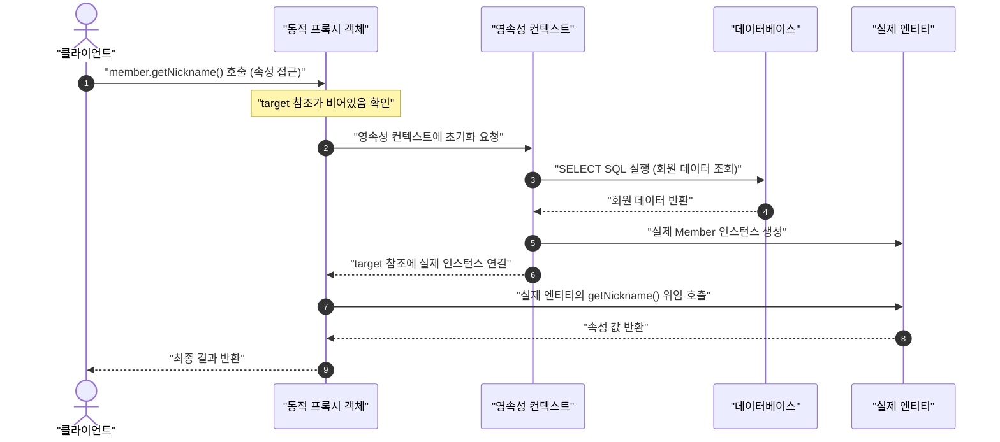

# 6. 스프링 부트 Data JPA 3 - 도메인 완성 및 계층 아키텍처 구축

## 학습 목표
- 지연 로딩(LAZY)과 프록시 객체의 초기화 메커니즘을 이해하고 안전한 DTO 변환 원칙을 습득함.
- Spring Data JPA의 JpaRepository 공통 인터페이스와 쿼리 메서드 기반 핵심 도메인 리포지토리를 구축함.
- 엔티티와 프레젠테이션 계층의 결합도를 낮추기 위한 불변 레코드 기반 Request 및 Response DTO 파이프라인을 설계함.
- 회원(Member) 및 게시글-댓글(Post-Comment) 연관관계 라이프사이클 서비스를 구현하고 테스트 코드로 즉시 검증함.
- RESTful 원칙에 입각한 웹 컨트롤러를 구축하여 웹 계층과 비즈니스 계층의 연동 흐름을 완성함.

---

## 목차
- [1. 지연 로딩 프록시와 Spring Data JPA 기본 아키텍처](#1-지연-로딩-프록시와-spring-data-jpa-기본-아키텍처)
  - [1.1 지연 로딩 메커니즘과 프록시 객체의 생명주기](#11-지연-로딩-메커니즘과-프록시-객체의-생명주기)
  - [1.2 Spring Data JPA 개요와 인터페이스 프록시 구현체 원리](#12-spring-data-jpa-개요와-인터페이스-프록시-구현체-원리)
  - [1.3 지연 로딩 환경의 안전한 DTO 변환 원칙](#13-지연-로딩-환경의-안전한-dto-변환-원칙)
- [2. SNS 도메인의 Repository 인터페이스 구축](#2-sns-도메인의-repository-인터페이스-구축)
  - [2.1 쿼리 메서드 동작 원리와 기본 명명 규칙](#21-쿼리-메서드-동작-원리와-기본-명명-규칙)
  - [2.2 회원 리포지토리(MemberRepository)](#22-회원-리포지토리memberrepository)
  - [2.3 게시글 리포지토리(PostRepository)](#23-게시글-리포지토리postrepository)
  - [2.4 댓글 리포지토리(CommentRepository)](#24-댓글-리포지토리commentrepository)
- [3. SNS 도메인의 DTO 구축](#3-sns-도메인의-dto-구축)
  - [3.1 회원 DTO(MemberDto)](#31-회원-dtomemberdto)
  - [3.2 댓글 DTO(CommentDto)](#32-댓글-dtocommentdto)
  - [3.3 게시글 DTO(PostDto)](#33-게시글-dtopostdto)
- [4. SNS 도메인의 비즈니스 서비스 계층 구현](#4-sns-도메인의-비즈니스-서비스-계층-구현)
  - [4.1 회원 서비스(MemberService)](#41-회원-서비스memberservice)
  - [4.2 게시글 및 댓글 서비스(PostService)](#42-게시글-및-댓글-서비스postservice)
- [5. SNS 도메인의 단위 테스트](#5-sns-도메인의-단위-테스트)
  - [5.1 회원 서비스 단위 테스트(MemberServiceTest)](#51-회원-서비스-단위-테스트memberservicetest)
  - [5.2 게시글 및 댓글 서비스 단위 테스트(PostServiceTest)](#52-게시글-및-댓글-서비스-단위-테스트postservicetest)
- [6. SNS 도메인의 RESTful API 컨트롤러와 웹 계층 연동](#6-sns-도메인의-restful-api-컨트롤러와-웹-계층-연동)
  - [6.1 회원 컨트롤러(MemberController)](#61-회원-컨트롤러membercontroller)
  - [6.2 게시글 및 댓글 컨트롤러(PostController)](#62-게시글-및-댓글-컨트롤러postcontroller)

---

# 1. 지연 로딩 프록시와 Spring Data JPA 기본 아키텍처

## 1.1 지연 로딩 메커니즘과 프록시 객체의 생명주기
JPA에서 연관관계 매핑 시 `FetchType.LAZY`를 지정하면, 연관된 엔티티는 데이터베이스에서 즉시 조회되지 않고 동적으로 생성된 프록시(Proxy) 객체 형태로 주입됨.

### 1.1.1 프록시 객체의 동작 특성
- 프록시는 실제 엔티티 클래스를 상속받아 런타임에 바이트코드 조작 라이브러리(ByteBuddy)로 동적 생성됨.
- 실제 객체의 참조(`target`)를 내부 멤버로 보관하며, 초기 상태에서는 `target`이 비어 있음.
- 프록시 객체의 메서드를 최초로 호출하여 속성 값에 접근하는 순간 영속성 컨텍스트에 초기화를 요청함.

### 1.1.2 프록시 객체 초기화 3단계 메커니즘
- 1단계: 클라이언트가 `post.getMember()`를 호출하여 연관 객체 참조를 획득함. 이때 반환되는 인스턴스는 실제 `Member`가 아닌 동적 프록시 객체(`Member$HibernateProxy`).
- 2단계: 클라이언트가 `member.getNickname()`처럼 식별자(PK) 이외의 실제 필드에 접근하는 메서드를 호출함.
- 3단계: 프록시 객체는 영속성 컨텍스트에 실제 엔티티 조회를 요청하고, 데이터베이스에서 SELECT SQL을 실행하여 실제 `Member` 인스턴스를 생성한 뒤 `target` 참조에 연결함. 이후 실제 인스턴스의 `getNickname()`을 위임 호출함.



### 1.1.3 트랜잭션 종료와 지연 로딩 예외(LazyInitializationException)
- 프록시 초기화는 반드시 트랜잭션 범위 안에서 영속성 컨텍스트가 살아있는 동안에만 수행 가능함.
- 트랜잭션이 종료(`@Transactional` 메서드 종료)된 후 컨트롤러나 뷰 템플릿 계층에서 프록시 객체의 필드에 접근하면 영속성 컨텍스트가 닫혀 있어 `LazyInitializationException`이 발생함.

## 1.2 Spring Data JPA 개요와 인터페이스 프록시 구현체 원리

### 1.2.1 순수 JPA의 보일러플레이트 한계와 도입 배경
- 순수 JPA 환경에서는 각 도메인 엔티티마다 개발자가 리포지토리 클래스를 만들고 `EntityManager`를 주입받아 반복적인 CRUD 코드(`persist`, `find` 등)를 직접 작성해야 했음.
- 도메인 엔티티가 늘어날수록 유사한 데이터 접근 코드가 중복되는 비효율이 발생함.
- Spring Data JPA는 이러한 반복을 제거하기 위해 개발자가 인터페이스만 선언하면 스프링이 런타임에 리포지토리 구현체를 메모리에 동적으로 생성하여 등록해 주는 데이터 접근 편의 프레임워크에 해당함.

### 1.2.2 JPA 기술 스택 3단계 계층 관계
- JPA (표준 규약): 자바 진영의 ORM 표준 인터페이스 명세(EntityManager 인터페이스 등).
- Hibernate (구현 엔진): JPA 표준 명세를 실제로 구현하여 SQL을 동적으로 생성하고 데이터베이스와 통신을 수행하는 오픈소스 ORM 프레임워크.
- Spring Data JPA (추상화 계층): JPA와 하이버네이트를 더욱 편리하게 다룰 수 있도록 리포지토리 인터페이스 기반의 구현체 자동 생성을 지원하는 스프링 모듈.

### 1.2.3 JpaRepository 상속 구조와 인터페이스 선택 기준
- 개발자는 리포지토리 인터페이스를 선언하고 `JpaRepository<엔티티타입, ID타입>`을 상속(`extends`)함.
- 예시
  ```java
  public interface MemberRepository extends JpaRepository<Member, Long> {
      // 인터페이스 선언만으로 기본 CRUD(save, findById, findAll, deleteById)가 자동 제공됨
  }
  ```
- 상속 계층 구조
  - `Repository` <- `CrudRepository` <- `ListCrudRepository` / `PagingAndSortingRepository` <- `JpaRepository`
- 인터페이스별 역할 및 상황별 선택 가이드
  - `JpaRepository`
    - 일반적인 스프링 부트 JPA 프로젝트의 표준 권장 선택.
    - 기본 CRUD 외에 표준 페이징/정렬, `List` 반환, 영속성 컨텍스트 제어(`flush()`, `saveAndFlush()`), 대량 삭제(`deleteAllInBatch()`)를 모두 지원하여 실무 대부분의 도메인에서 기본 상속함.
  - `CrudRepository` / `ListCrudRepository`
    - 페이징이나 JPA 고유 기능 없이 순수 C·R·U·D 기능만 필요할 때 사용.
    - NoSQL(Spring Data Redis 등)이나 Spring Data JDBC 등 타 저장소와 일관된 CRUD 규격을 유지할 때도 활용됨.
  - `PagingAndSortingRepository`
    - 데이터 등록/수정/삭제 권한 없이 대용량 목록 조회 및 페이징 기능만 전담하는 조회 전용 인터페이스를 분리할 때 사용.
  - `Repository`
    - 최상위 마커 인터페이스로 기본 제공 메서드가 존재하지 않음.
    - 인터페이스 분리 원칙(ISP)에 따라 전체 조회나 삭제를 원천 차단하고, 특정 단건 조회(`findById`) 등 명시적으로 허용한 메서드만 외부에 제한적으로 노출하고자 할 때 직접 상속함.

### 1.2.4 인터페이스 프록시 생성 과정
- 스프링 부트 구동 시 메인 패키지 하위의 리포지토리 인터페이스를 자동으로 탐색.
- 스프링 AOP 프록시 팩토리가 각 인터페이스에 대해 `SimpleJpaRepository` 클래스를 기반 타깃으로 하는 프록시 인스턴스 동적 생성.
- 개발자가 구현 클래스를 직접 만들지 않아도 의존성 주입(`@Autowired` 또는 생성자 주입)을 통해 서비스 계층에서 즉시 사용 가능.

## 1.3 지연 로딩 환경의 안전한 DTO 변환 원칙
엔티티는 데이터베이스 테이블 구조와 직접 맞물려 있는 영속 객체이므로, 프레젠테이션 계층(Controller, View)으로 직접 노출하지 않아야 함.

### 1.3.1 엔티티 직접 노출 시 발생하는 문제점
- Jackson 라이브러리가 양방향 연관관계 엔티티를 JSON으로 직렬화할 때 상호 참조로 인한 `StackOverflowError` 무한 루프 발생.
- `FetchType.LAZY` 프록시 객체가 JSON 직렬화 대상이 될 때 초기화 실패 예외 또는 의도치 않은 대량 추가 쿼리 발생.
- 화면 요구사항 변경(특정 컬럼 포맷팅, 추가 연산 필드)이 도메인 엔티티 코드에 침범하여 테이블 설계가 훼손됨.

### 1.3.2 요청(Request)과 응답(Response) DTO 분리 원칙
- 데이터 흐름 방향과 요구 필드가 완전히 다르므로 반드시 별도의 DTO로 분리해야 함.
- 요청 DTO: 클라이언트 입력값 수신, 비밀번호(`password`) 및 입력 검증 어노테이션(`@NotBlank`, `@Email` 등) 포함. 데이터베이스 자동 생성 값(`id`, `createdAt`)은 제외.
- 응답 DTO: 클라이언트 화면 출력 데이터, 비밀번호 등 민감 정보는 배제하고 화면에 필요한 식별자(`id`), 포맷팅된 일시, 가공 필드(작성자 닉네임, 댓글 수 등) 포함.
- 단일 DTO 재사용 시 비밀번호 누출이나 클라이언트의 임의 식별자 변조(Mass Assignment) 취약점이 발생함.

### 1.3.3 최신 DTO 설계 및 네이밍 트렌드
- 자바 레코드(Java Record) 활용: 불변성(Immutable)을 보장하며 생성자, Getter, equals, hashCode, toString이 자동 생성되어 보일러플레이트 코드를 제거함.
- 도메인 단위 중첩 레코드(Static Nested Record) 패턴: 도메인마다 수많은 DTO 클래스 파일이 난립하는 것을 방지하기 위해 단일 외부 클래스(`MemberDto`) 내부에 요청/응답 레코드(`CreateRequest`, `Response`)를 중첩 선언하여 높은 응집도를 유지함.
- 명확한 네이밍 컨벤션: 클래스명 끝에 습관적으로 붙이던 사족 접미사(`...Dto`)를 지양하고, `Request`, `Response`로 역할을 명확히 규정함 (`MemberDto.CreateRequest`, `MemberDto.Response`).

### 1.3.4 안전한 DTO 변환 파이프라인 원칙
- 엔티티의 조회 및 DTO 변환은 반드시 트랜잭션 경계(`@Transactional`) 내부인 서비스 계층에서 완결해야 함.
- 조회할 필드만 선별하여 불변 데이터 객체로 변환한 후 컨트롤러로 전달.
- 화면에서 전달받은 요청 데이터는 Request DTO의 `toEntity()` 또는 서비스 계층 생성자 로직을 통해 엔티티로 변환하고, 응답 데이터는 DTO의 정적 팩토리 메서드(`from()`)를 통해 생성.

- MemberDto.java 예시
  ```java
  package net.likelion.bebc25.jpasns.dto;

  import net.likelion.bebc25.jpasns.domain.Member;
  import net.likelion.bebc25.jpasns.domain.Role;

  public class MemberDto {

      // 화면 요청 데이터를 안전하게 수신하는 불변 Request DTO
      public record CreateRequest(
          String email,
          String password,
          String nickname
      ) {
          public Member toEntity() {
              return new Member(email, password, nickname, Role.USER);
          }
      }

      // 엔티티 직접 노출과 순환 참조를 방지하는 Response DTO
      public record Response(
          Long id,
          String email,
          String nickname,
          String role
      ) {
          // 트랜잭션 내부에서 엔티티를 DTO로 변환하는 정적 팩토리 메서드
          public static Response from(Member member) {
              return new Response(
                  member.getId(),
                  member.getEmail(),
                  member.getNickname(),
                  member.getRole().name()
              );
          }
      }
  }
  ```

---

# 2. SNS 도메인의 Repository 인터페이스 구축

## 2.1 쿼리 메서드 동작 원리와 기본 명명 규칙
JpaRepository는 인터페이스 상속만으로 기본 CRUD 메서드(`save`, `findById`, `findAll`, `deleteById` 등)를 자동 제공함. 그러나 실제 도메인 서비스에서는 식별자(PK)가 아닌 비식별자 일반 컬럼(이메일, 닉네임, 작성자 등)을 조건으로 데이터를 조회하거나 존재 여부를 확인해야 하는 상황이 빈번하게 발생함.

### 2.1.1 쿼리 메서드의 필요성
- `findById`는 오직 `@Id` 기본 키 컬럼 조건만 지원하므로, 로그인 인증이나 중복 검사처럼 `email` 컬럼을 조건으로 조회하는 메서드가 필요함.
- 별도의 구현 클래스를 작성하지 않고 인터페이스에 특정 명명 규칙을 준수하여 메서드 이름만 선언하면 프록시가 필요한 쿼리를 자동 조립함.

### 2.1.2 쿼리 메서드의 동작 메커니즘
- 메서드 이름 구문 분석: 애플리케이션 구동 시 Spring Data JPA가 인터페이스에 선언된 메서드 이름(`findByEmail`)의 키워드(`findBy`)와 엔티티 속성명(`Email`)을 파싱함.
- JPQL 동적 조립: 분석된 정보를 바탕으로 `SELECT m FROM Member m WHERE m.email = :email` 형태의 JPQL을 동적으로 생성하고, 프록시 객체의 실행 로직으로 바인딩함.
- 속성 검증: 엔티티에 존재하지 않는 필드명을 메서드 이름에 잘못 명시하면 애플리케이션 시작 시점에 예외(`PropertyReferenceException`)를 발생시켜 런타임 버그를 사전에 방지함.

### 2.1.3 기본 명명 키워드
- `findBy + 속성명`: 조건에 맞는 단건(`Optional<T>`) 또는 다건(`List<T>`) 데이터 조회.
- `existsBy + 속성명`: 조건에 부합하는 레코드의 존재 여부를 boolean 값으로 확인 (`SELECT count(*) > 0`).
- `countBy + 속성명`: 조건에 부합하는 레코드의 총 건수 반환.
- 상세한 지원 키워드(`Containing`, `Between`, `In` 등)와 페이징 연계 및 복합 쿼리 최적화는 4편에서 다룸.

### 2.1.4 단건 조회 반환 타입과 Optional 컨테이너
- 도입 목적: 데이터베이스 단건 조회 시 조건에 일치하는 데이터가 존재하지 않을 때 `null` 대신 비어 있는 `Optional.empty()`를 반환하여 `NullPointerException` 발생을 원천 방지함.
- 데이터 부재 처리 강제: 반환 타입이 `Optional<T>`로 선언되면 호출하는 서비스 계층에서 값이 비어있을 가능성을 인지하고 부재 상황을 명시적으로 처리하도록 유도함.
- 단건 조회와 다건 조회의 차이: 다건 조회(`List<T>`)는 조회 결과가 없더라도 `null`이 아닌 빈 컬렉션(`[]`)을 반환하므로 `Optional`을 래핑하지 않고 컬렉션 객체를 직접 반환함.

#### 1) orElseThrow()
- 데이터가 존재하면 엔티티 인스턴스를 반환하고, 부재 시 지정한 비즈니스 예외(`EntityNotFoundException`, `IllegalArgumentException` 등)를 즉시 발생시킴.
- SNS 활용 사례: 게시글 단건 상세 조회 시 데이터가 없으면 예외를 발생시켜 404 에러로 처리.
  ```java
  Post post = postRepository.findById(postId)
      .orElseThrow(() -> new IllegalArgumentException("존재하지 않는 게시글입니다. id=" + postId));
  ```

#### 2) orElseGet()
- 데이터가 존재하지 않을 때에만 람다 식을 실행하여 대체 객체를 동적으로 생성함.
- SNS 활용 사례: 본문 해시태그 파싱 시 기존 태그는 재사용하고, 최초 등록 태그일 때만 DB 저장을 수행함.
  ```java
  Tag tag = tagRepository.findByName(tagName)
      .orElseGet(() -> tagRepository.save(new Tag(tagName)));
  ```

#### 3) ifPresentOrElse()
- 데이터가 존재할 때와 부재할 때의 후속 비즈니스 로직을 함수형으로 명확히 분기함.
- SNS 활용 사례: 게시글 좋아요 요청 시 이미 등록되어 있으면 취소(삭제)하고, 없으면 신규 등록함.
  ```java
  postLikeRepository.findByMemberAndPost(member, post)
      .ifPresentOrElse(
          postLikeRepository::delete,
          () -> postLikeRepository.save(new PostLike(post, member))
      );
  ```

#### 4) map()
- 조회된 엔티티가 존재할 때에만 특정 속성을 추출하거나 가공 체이닝을 수행함.
- SNS 활용 사례: 회원 상세 정보가 존재할 때만 소개글을 추출하고 부재 시 기본 문구를 반환함.
  ```java
  String introduction = memberDetailRepository.findById(memberId)
      .map(MemberDetail::getIntroduction)
      .orElse("소개글이 없습니다.");
  ```

## 2.2 회원 리포지토리(MemberRepository)
회원 엔티티(`Member`)의 기본 키(PK) 기반 CRUD를 상속받고, 로그인과 중복 가입 방지를 위한 비식별자 속성(이메일, 닉네임) 조회 쿼리 메서드를 선언함.

- MemberRepository (src/main/java/net/likelion/bebc25/jpasns/repository/MemberRepository.java)
  ```java
  package net.likelion.bebc25.jpasns.repository;

  import java.util.Optional;
  import net.likelion.bebc25.jpasns.domain.Member;
  import org.springframework.data.jpa.repository.JpaRepository;

  public interface MemberRepository extends JpaRepository<Member, Long> {

      // 이메일 단건 조회 (로그인 및 회원 정보 확인용)
      Optional<Member> findByEmail(String email);

      // 이메일 중복 가입 검증용 존재 여부 확인
      boolean existsByEmail(String email);

      // 닉네임 중복 검증용 존재 여부 확인
      boolean existsByNickname(String nickname);
  }
  ```

## 2.3 게시글 리포지토리(PostRepository)
게시글(`Post`) 엔티티의 기본 CRUD를 상속받고, 연관된 작성자(`Member`) 기준 조건 검색 및 작성일시 내림차순 정렬 쿼리 메서드를 선언함.

- PostRepository (src/main/java/net/likelion/bebc25/jpasns/repository/PostRepository.java)
  ```java
  package net.likelion.bebc25.jpasns.repository;

  import java.util.List;
  import net.likelion.bebc25.jpasns.domain.Member;
  import net.likelion.bebc25.jpasns.domain.Post;
  import org.springframework.data.jpa.repository.JpaRepository;

  public interface PostRepository extends JpaRepository<Post, Long> {

      // 특정 회원이 작성한 게시글 목록을 최신 등록순으로 정렬 조회
      List<Post> findByMemberOrderByCreatedAtDesc(Member member);
  }
  ```

## 2.4 댓글 리포지토리(CommentRepository)
게시글(`Post`)에 종속된 댓글(`Comment`) 엔티티의 기본 CRUD를 상속받고, 대상 게시글 기준 작성일시 오름차순 정렬 쿼리 메서드를 선언함.

- CommentRepository (src/main/java/net/likelion/bebc25/jpasns/repository/CommentRepository.java)
  ```java
  package net.likelion.bebc25.jpasns.repository;

  import java.util.List;
  import net.likelion.bebc25.jpasns.domain.Comment;
  import net.likelion.bebc25.jpasns.domain.Post;
  import org.springframework.data.jpa.repository.JpaRepository;

  public interface CommentRepository extends JpaRepository<Comment, Long> {

      // 특정 게시글에 작성된 댓글 목록을 작성순으로 정렬 조회
      List<Comment> findByPostOrderByCreatedAtAsc(Post post);
  }
  ```

---

# 3. SNS 도메인의 DTO 구축

## 3.1 회원 DTO(MemberDto)
회원 가입 요청 데이터 수신과 회원 프로필 응답을 위한 불변 레코드(Record) DTO.

- MemberDto (src/main/java/net/likelion/bebc25/jpasns/dto/MemberDto.java)
  ```java
  package net.likelion.bebc25.jpasns.dto;

  import net.likelion.bebc25.jpasns.domain.Member;
  import net.likelion.bebc25.jpasns.domain.Role;

  public class MemberDto {

      // 회원 가입 요청 데이터를 수신하는 불변 Request DTO
      public record CreateRequest(
          String email,
          String password,
          String nickname
      ) {
          public Member toEntity() {
              return new Member(email, password, nickname, Role.USER);
          }
      }

      // 엔티티 직접 노출을 방지하는 불변 Response DTO
      public record Response(
          Long id,
          String email,
          String nickname,
          String role
      ) {
          public static Response from(Member member) {
              return new Response(
                  member.getId(),
                  member.getEmail(),
                  member.getNickname(),
                  member.getRole().name()
              );
          }
      }
  }
  ```

## 3.2 댓글 DTO(CommentDto)
댓글 등록 요청 데이터 수신과 작성자 닉네임이 포함된 댓글 목록 응답을 위한 불변 레코드 DTO.

- CommentDto (src/main/java/net/likelion/bebc25/jpasns/dto/CommentDto.java)
  ```java
  package net.likelion.bebc25.jpasns.dto;

  import java.time.LocalDateTime;
  import net.likelion.bebc25.jpasns.domain.Comment;

  public class CommentDto {

      public record CreateRequest(
          String content
      ) {}

      public record Response(
          Long id,
          String content,
          String authorNickname,
          LocalDateTime createdAt
      ) {
          public static Response from(Comment comment) {
              return new Response(
                  comment.getId(),
                  comment.getContent(),
                  comment.getMember().getNickname(),
                  comment.getCreatedAt()
              );
          }
      }
  }
  ```

## 3.3 게시글 DTO(PostDto)
게시글 등록 요청 데이터 수신과 단건 상세 조회 시 연관된 댓글 목록을 포함하여 반환하는 불변 레코드 DTO.

- PostDto (src/main/java/net/likelion/bebc25/jpasns/dto/PostDto.java)
  ```java
  package net.likelion.bebc25.jpasns.dto;

  import java.time.LocalDateTime;
  import java.util.List;
  import net.likelion.bebc25.jpasns.domain.Post;

  public class PostDto {

      public record CreateRequest(
          String content
      ) {}

      public record Response(
          Long id,
          String content,
          String authorNickname,
          LocalDateTime createdAt
      ) {
          public static Response from(Post post) {
              return new Response(
                  post.getId(),
                  post.getContent(),
                  post.getMember().getNickname(),
                  post.getCreatedAt()
              );
          }
      }

      public record DetailResponse(
          Long id,
          String content,
          String authorNickname,
          LocalDateTime createdAt,
          List<CommentDto.Response> comments
      ) {
          public static DetailResponse from(Post post) {
              List<CommentDto.Response> comments = post.getComments().stream()
                  .map(CommentDto.Response::from)
                  .toList();

              return new DetailResponse(
                  post.getId(),
                  post.getContent(),
                  post.getMember().getNickname(),
                  post.getCreatedAt(),
                  comments
              );
          }
      }
  }
  ```

---

# 4. SNS 도메인의 비즈니스 서비스 계층 구현

## 4.1 회원 서비스(MemberService)
회원 가입 시 이메일 중복 여부를 검증하고 엔티티 저장 및 응답 DTO 변환을 수행하는 서비스 계층.

- MemberService (src/main/java/net/likelion/bebc25/jpasns/service/MemberService.java)
  ```java
  package net.likelion.bebc25.jpasns.service;

  import lombok.RequiredArgsConstructor;
  import net.likelion.bebc25.jpasns.domain.Member;
  import net.likelion.bebc25.jpasns.dto.MemberDto;
  import net.likelion.bebc25.jpasns.repository.MemberRepository;
  import org.springframework.stereotype.Service;
  import org.springframework.transaction.annotation.Transactional;

  @Service
  @RequiredArgsConstructor // final 필드를 매개변수로 받는 생성자를 자동 생성하여 스프링 생성자 주입 수행
  @Transactional(readOnly = true)
  public class MemberService {

      private final MemberRepository memberRepository;

      // 회원 가입: 중복 검증 -> DTO의 toEntity() 변환 -> 영속화 -> Response DTO 반환
      @Transactional // 쓰기 트랜잭션 적용
      public MemberDto.Response signUp(MemberDto.CreateRequest request) {
          if (memberRepository.existsByEmail(request.email())) {
            throw new IllegalArgumentException("이미 사용 중인 이메일입니다: " + request.email());
          }

          Member member = request.toEntity();
          Member savedMember = memberRepository.save(member);
          return MemberDto.Response.from(savedMember);
      }

      // 단건 조회: 엔티티 조회 후 트랜잭션 내부에서 안전하게 Response DTO로 변환
      public MemberDto.Response getMember(Long id) {
          Member member = memberRepository.findById(id)
              .orElseThrow(() -> new IllegalArgumentException("존재하지 않는 회원입니다. id=" + id));
          return MemberDto.Response.from(member);
      }
  }
  ```

## 4.2 게시글 및 댓글 서비스(PostService)
게시글 등록, 단건 상세 조회와 연관 댓글 작성을 트랜잭션 경계 내부에서 처리하는 서비스 계층.

- PostService (src/main/java/net/likelion/bebc25/jpasns/service/PostService.java)
  ```java
  package net.likelion.bebc25.jpasns.service;

  import lombok.RequiredArgsConstructor;
  import net.likelion.bebc25.jpasns.domain.Comment;
  import net.likelion.bebc25.jpasns.domain.Member;
  import net.likelion.bebc25.jpasns.domain.Post;
  import net.likelion.bebc25.jpasns.dto.CommentDto;
  import net.likelion.bebc25.jpasns.dto.PostDto;
  import net.likelion.bebc25.jpasns.repository.CommentRepository;
  import net.likelion.bebc25.jpasns.repository.MemberRepository;
  import net.likelion.bebc25.jpasns.repository.PostRepository;
  import org.springframework.stereotype.Service;
  import org.springframework.transaction.annotation.Transactional;

  @Service
  @RequiredArgsConstructor
  @Transactional(readOnly = true)
  public class PostService {

      private final PostRepository postRepository;
      private final CommentRepository commentRepository;
      private final MemberRepository memberRepository;

      @Transactional
      public PostDto.Response createPost(Long memberId, PostDto.CreateRequest request){
          Member member = memberRepository.findById(memberId)
                          .orElseThrow(() -> new IllegalArgumentException("존재하지 않는 회원입니다. id=" + memberId));
          Post post = new Post(member, request.content());
          Post savedPost = postRepository.save(post);
          return PostDto.Response.from(savedPost);
      }

      public PostDto.DetailResponse getPost(Long id){
          Post post = postRepository.findById(id)
                  .orElseThrow(() -> new IllegalArgumentException("존재하지 않는 게시글 입니다. id=" + id));
          return PostDto.DetailResponse.from(post);
      }

      @Transactional
      public CommentDto.Response addComment(Long postId, Long memberId, CommentDto.CreateRequest request){
          Post post = postRepository.findById(postId)
                  .orElseThrow(() -> new IllegalArgumentException("존재하지 않는 게시글 입니다. id=" + postId));
          Member member = memberRepository.findById(memberId)
                  .orElseThrow(() -> new IllegalArgumentException("존재하지 않는 회원입니다. id=" + memberId));
          
          Comment comment = new Comment(request.content(), member);
          Comment savedComment = commentRepository.save(comment);

          // 영속성 컨텍스트의 동기화를 위해 필요
          post.addComment(savedComment);
          
          return CommentDto.Response.from(comment);
      }
  }
  ```

---

# 5. SNS 도메인의 단위 테스트

## 5.1 회원 서비스 단위 테스트(MemberServiceTest)
회원 가입 및 단건 조회 DTO 변환과 중복 이메일 가입 예외 처리를 검증하는 단위 테스트.

- MemberServiceTest (src/test/java/net/likelion/bebc25/jpasns/service/MemberServiceTest.java)
  ```java
  package net.likelion.bebc25.jpasns.service;

  import static org.assertj.core.api.Assertions.assertThat;
  import static org.assertj.core.api.Assertions.assertThatThrownBy;

  import net.likelion.bebc25.jpasns.dto.MemberDto;
  import org.junit.jupiter.api.DisplayName;
  import org.junit.jupiter.api.Test;
  import org.springframework.beans.factory.annotation.Autowired;
  import org.springframework.boot.test.context.SpringBootTest;
  import org.springframework.transaction.annotation.Transactional;

  @SpringBootTest
  @Transactional
  class MemberServiceTest {

      @Autowired
      private MemberService memberService;

      @Test
      @DisplayName("회원 가입 및 단건 조회 DTO 변환 검증")
      void signUpAndGetMember() {
          // 회원 가입
          MemberDto.CreateRequest request = new MemberDto.CreateRequest(
              "haru@naver.com",
              "1234",
              "하루"
          );
          MemberDto.Response createResponse = memberService.signUp(request);

          // 회원 단건 조회
          MemberDto.Response response = memberService.getMember(createResponse.id());

          assertThat(response.id()).isEqualTo(createResponse.id());
          assertThat(response.email()).isEqualTo("haru@naver.com");
          assertThat(response.nickname()).isEqualTo("하루");
      }

      @Test
      @DisplayName("이메일 중복 가입 시 예외 발생 검증")
      void duplicateEmailException() {
          MemberDto.CreateRequest request1 = new MemberDto.CreateRequest("namu@naver.com", "1111", "나무");
          memberService.signUp(request1);

          MemberDto.CreateRequest request2 = new MemberDto.CreateRequest("namu@naver.com", "2222", "나무를가장한하루");

          assertThatThrownBy(() -> memberService.signUp(request2))
                  .isInstanceOf(IllegalArgumentException.class)
                  .hasMessageContaining("사용중");
      }
  }
  ```

## 5.2 게시글 및 댓글 서비스 단위 테스트(PostServiceTest)
회원 기준 게시글 등록, 댓글 연관관계 매핑 및 지연 로딩 기반 상세 조회를 검증하는 단위 테스트.

- PostServiceTest (src/test/java/net/likelion/bebc25/jpasns/service/PostServiceTest.java)
  ```java
  package net.likelion.bebc25.jpasns.service;

  import net.likelion.bebc25.jpasns.domain.Member;
  import net.likelion.bebc25.jpasns.dto.CommentDto;
  import net.likelion.bebc25.jpasns.dto.PostDto;
  import net.likelion.bebc25.jpasns.repository.MemberRepository;
  import org.junit.jupiter.api.BeforeEach;
  import org.junit.jupiter.api.DisplayName;
  import org.junit.jupiter.api.Test;
  import org.springframework.beans.factory.annotation.Autowired;
  import org.springframework.boot.test.context.SpringBootTest;
  import org.springframework.transaction.annotation.Transactional;

  import static org.assertj.core.api.Assertions.assertThat;

  @SpringBootTest
  @Transactional
  public class PostServiceTest {
      @Autowired
      private MemberRepository memberRepository;
      @Autowired
      private PostService postService;

      private Long memberId;

      @BeforeEach
      void setUp(){
          Member member = new Member("haru@naver.com", "1234", "하루");
          memberRepository.save(member);
          memberId = member.getId();
      }

      @Test
      @DisplayName("게시글 생성 및 댓글 등록 후 상세 조회")
      void createPostAndComments(){
          PostDto.CreateRequest postRequest = new PostDto.CreateRequest("멍멍");
          PostDto.Response postResponse = postService.createPost(memberId, postRequest);

          postService.addComment(postResponse.id(), memberId, new CommentDto.CreateRequest("야옹"));
          postService.addComment(postResponse.id(), memberId, new CommentDto.CreateRequest("왈왈"));

          PostDto.DetailResponse response = postService.getPost(postResponse.id());

          assertThat(postResponse.content()).isEqualTo("멍멍");
          assertThat(postResponse.authorNickname()).isEqualTo("하루");
          assertThat(response.content()).isEqualTo("멍멍");
          assertThat(response.authorNickname()).isEqualTo("하루");
          assertThat(response.comments()).hasSize(2);
          assertThat(response.comments().getFirst().id()).isEqualTo(1);
          assertThat(response.comments().get(1).content()).isEqualTo("왈왈");
      }
  }
  ```

---

# 6. SNS 도메인의 RESTful API 컨트롤러와 웹 계층 연동

## 6.1 회원 컨트롤러(MemberController)
회원 가입 및 회원 프로필 정보 조회를 처리하고 생성된 리소스의 URI와 상태 코드를 반환하는 웹 계층 컨트롤러.

- MemberController (src/main/java/net/likelion/bebc25/jpasns/controller/MemberController.java)
  ```java
  package net.likelion.bebc25.jpasns.controller;

  import lombok.RequiredArgsConstructor;
  import net.likelion.bebc25.jpasns.dto.MemberDto;
  import net.likelion.bebc25.jpasns.service.MemberService;
  import org.springframework.http.ResponseEntity;
  import org.springframework.web.bind.annotation.*;

  import java.net.URI;

  @RestController
  @RequestMapping("/api/v1/members")
  @RequiredArgsConstructor
  public class MemberController {

      private final MemberService memberService;

      @PostMapping
      public ResponseEntity<MemberDto.Response> signUp(@RequestBody MemberDto.CreateRequest request) {
          MemberDto.Response response = memberService.signUp(request);
          return ResponseEntity.created(URI.create("/api/v1/members/" + response.id())).body(response);
      }

      @GetMapping("/{id}")
      public ResponseEntity<MemberDto.Response> getMember(@PathVariable Long id) {
          MemberDto.Response response = memberService.getMember(id);
          return ResponseEntity.ok(response);
      }
  }
  ```

## 6.2 게시글 및 댓글 컨트롤러(PostController)
게시글 등록, 단건 상세 조회와 댓글 작성 요청을 처리하고 적절한 HTTP 응답을 반환하는 웹 계층 컨트롤러.

- PostController (src/main/java/net/likelion/bebc25/jpasns/controller/PostController.java)
  ```java
  package net.likelion.bebc25.jpasns.controller;

  import lombok.RequiredArgsConstructor;
  import net.likelion.bebc25.jpasns.dto.CommentDto;
  import net.likelion.bebc25.jpasns.dto.PostDto;
  import net.likelion.bebc25.jpasns.service.PostService;
  import org.springframework.http.ResponseEntity;
  import org.springframework.web.bind.annotation.*;

  import java.net.URI;

  @RestController
  @RequestMapping("/api/v1/posts")
  @RequiredArgsConstructor
  public class PostController {

      private final PostService postService;

      @PostMapping
      public ResponseEntity<PostDto.Response> createPost(
              @RequestHeader("X-Member-Id") Long memberId,
              @RequestBody PostDto.CreateRequest request
      ){
          PostDto.Response response = postService.createPost(memberId, request);
          return ResponseEntity.created(URI.create("/api/v1/posts/" + response.id())).body(response);
      }

      @GetMapping("/{id}")
      public ResponseEntity<PostDto.DetailResponse> getPost(@PathVariable Long id){
          PostDto.DetailResponse response = postService.getPost(id);
          return ResponseEntity.ok(response);
      }

      @PostMapping("/{id}/comments")
      public ResponseEntity<CommentDto.Response> addComment(
              @RequestHeader("X-Member-Id") Long memberId,
              @PathVariable Long id,
              @RequestBody CommentDto.CreateRequest request
      ){
          CommentDto.Response response = postService.addComment(id, memberId, request);
          return ResponseEntity.created(URI.create("/api/v1/posts/" + id + "/comments/" + response.id())).body(response);

      }
  }
  ```

---

